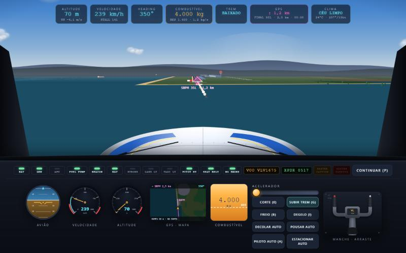
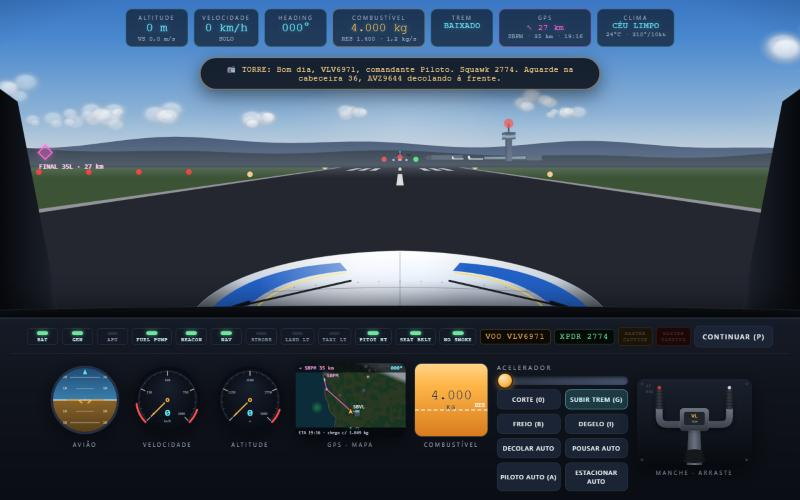
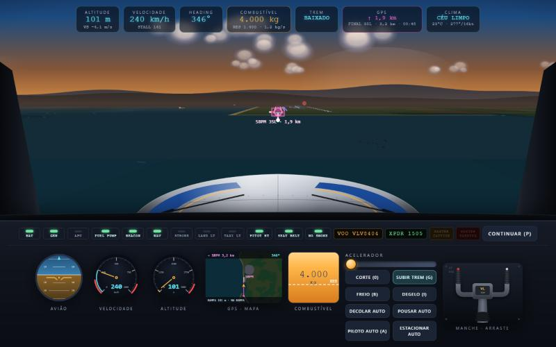
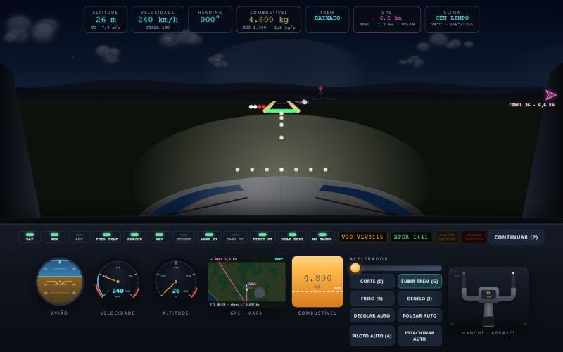
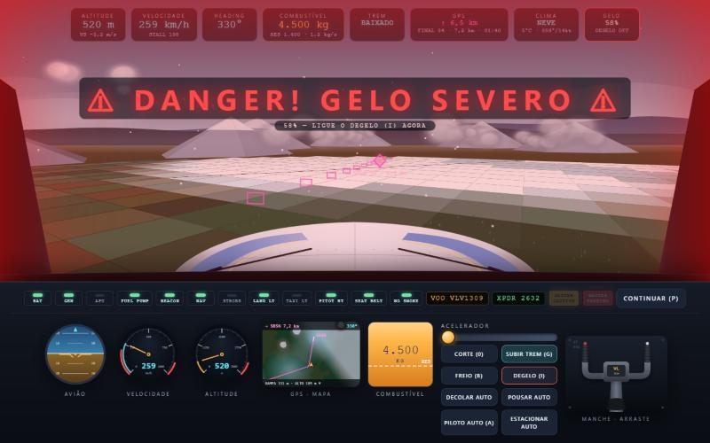
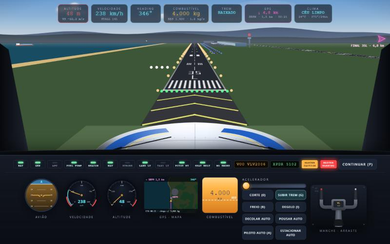
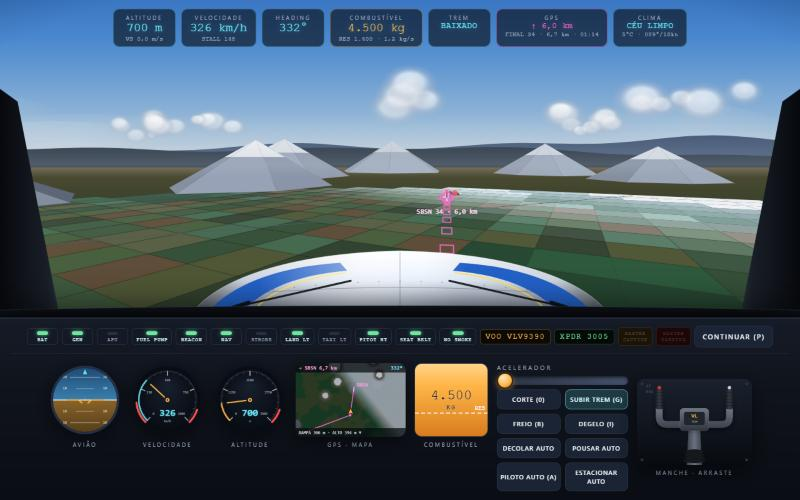
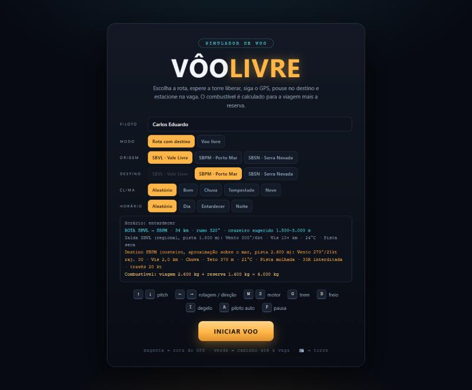
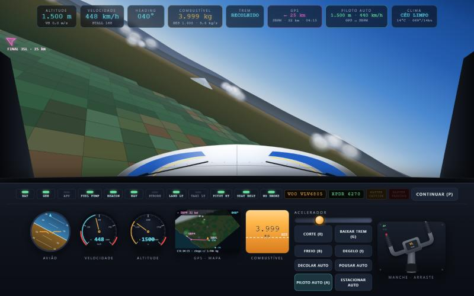

# ✈️ Vôo Livre — Simulador de Voo no Navegador

> Projeto acadêmico da disciplina **Sistemas Distribuídos e Computação Paralela**, do curso de **Engenharia de Software** da **Wyden UNIFAVIP**. Tema: **Desenvolvimento de software assistido por IA**, ou seja, construir um software completo conduzindo o desenvolvimento por linguagem natural com apoio de modelos de IA, e observar na prática a infraestrutura paralela e distribuída que faz esses modelos funcionarem.

  

  <a href="https://carlos-esi.github.io/voo-livre/"><b>▶ Jogar online</b></a>
  ·
  <a href="#-como-rodar">Como rodar</a>
  ·
  <a href="#-o-projeto-na-disciplina">Sobre o trabalho</a>

---

## 🎓 O projeto na disciplina

A proposta do projeto foi aplicar na prática o **desenvolvimento de software assistido por IA**: em vez de escrever cada linha à mão, o desenvolvedor atua como **idealizador, product owner e testador**, descrevendo o que quer em linguagem natural, avaliando o resultado e pedindo ajustes até chegar no produto final.

Essa abordagem é popularmente chamada de *vibe coding*. A diferença é que, no sentido original do termo, o código gerado é aceito sem revisão. Aqui foi o contrário: **cada funcionalidade foi testada, validada e corrigida** antes de seguir para a próxima.

Escolhi um simulador de voo porque é um tema que eu gosto e que tem muita regra do mundo real (aerodinâmica, meteorologia, controle de tráfego aéreo, sinalização de pista). Isso me obrigou a **pesquisar e entender o domínio** para saber o que pedir e para perceber quando algo estava errado.

### As duas fases do projeto

**Fase 1: modelos locais com GPU online**
A primeira versão do simulador foi construída com **três modelos de IA diferentes rodando localmente**, usando uma **GPU online** para processar. Comparar os modelos fez parte do estudo: cada um tinha pontos fortes e fracos, e eu fui combinando as melhores respostas. Saiu dessa fase a base do jogo:

- cabine com instrumentos (horizonte artificial, velocímetro, altímetro e bússola);
- física de voo, aceleração e trem de pouso;
- um aeroporto com pista, luzes, hangares e torre;
- decolagem e pouso automáticos;
- turbulência, combustível e alerta de MAYDAY.

**Fase 2: refinamento com modelo via API**
Com a base pronta, passei a usar um **modelo de IA acessado via API** para evoluir o projeto. Foi nessa fase que entraram as funcionalidades maiores: os três aeroportos, o GPS, o clima, o gelo, o tráfego aéreo com torre, o piloto automático de cruzeiro, o ciclo dia e noite, as marcações de pista ICAO e o manche no painel.

### Onde entram Sistemas Distribuídos e Computação Paralela

Usar IA para programar parece algo "de software", mas por baixo tudo depende de **hardware paralelo** e de **infraestrutura distribuída**. As duas fases do projeto me colocaram em contato com cada um desses lados:

| Área da disciplina | Papel na IA | Onde apareceu no projeto |
|---|---|---|
| **Computação paralela** | Acelerar treino e inferência (GPU, otimização) | **Fase 1:** modelos rodando localmente numa GPU online |
| **Sistemas distribuídos** | Escalar treino e servir modelos em escala | **Fase 2:** modelo servido via API por uma infraestrutura remota |

**Computação paralela na fase 1.** A IA roda quase inteiramente em hardware paralelo: GPUs e TPUs, CUDA, vetorização, *data parallelism* e *model parallelism*. Gerar cada resposta é, no fundo, uma enorme quantidade de multiplicações de matrizes feitas em paralelo pelos núcleos da GPU. Na prática eu senti isso:
- a **memória da GPU** limita o tamanho do modelo e o tamanho do contexto que cabe nela;
- a **velocidade de geração** (tokens por segundo) depende diretamente do hardware disponível;
- modelos maiores respondiam melhor, mas eram mais lentos ou nem cabiam.

**Sistemas distribuídos na fase 2.** Treinar modelos grandes (LLMs, visão computacional) é essencialmente um problema de sistemas distribuídos: treino paralelo em várias máquinas, sincronização de gradientes, comunicação entre nós e tolerância a falhas. E para **servir** esses modelos para muita gente ao mesmo tempo entram conceitos que vimos na disciplina, como **balanceamento de carga**, **filas de mensagens**, **consistência** e **disponibilidade**. Ao usar um modelo via API, eu estava consumindo exatamente esse tipo de infraestrutura: a requisição sai da minha máquina, é distribuída para um cluster de GPUs e volta como resposta, com uma latência bem menor do que a da fase 1.

**Paralelos dentro do próprio simulador.** Sem eu ter planejado, alguns conceitos da disciplina apareceram no jogo:
- **A pista é um recurso compartilhado com exclusão mútua.** Só um avião pode usá-la por vez. A torre funciona como **coordenador central**: autoriza a decolagem, coloca os pousos em sequência ("número 2 para pouso") e manda arremeter quando a pista está ocupada.
- **Os aviões são agentes independentes** que atualizam o próprio estado em paralelo, a cada quadro, e precisam se coordenar para não colidir.
- **O TCAS é uma forma de coordenação descentralizada:** quando dois aviões se aproximam, cada um recebe uma ordem complementar (um sobe, o outro desce) sem depender da torre.
- **O MAYDAY funciona como prioridade numa fila:** o avião em emergência passa na frente e os outros entram em espera.

### Como foi o processo

Nas duas fases o desenvolvimento seguiu **ciclos curtos**, sempre no mesmo esquema:

1. **Pedir** uma funcionalidade em linguagem natural (ex.: *"coloca gelo nas asas quando estiver nevando, com alerta e botão de degelo"*).
2. **Testar** no navegador: decolar, voar, pousar, forçar o erro.
3. **Avaliar** o que ficou estranho ou irreal e **refinar o pedido**.
4. Repetir até ficar do jeito que eu queria.

Alguns exemplos de refinamentos que precisei pedir depois de testar:

| O que eu pedi | O que aconteceu no teste | Ajuste |
|---|---|---|
| Piloto automático de pouso | Com vento cruzado forte, o avião entrava alto na final e arremetia sem parar | Ponto de entrada da aproximação recalculado para a rampa de 5% |
| Tráfego aéreo nos aeroportos | O avião autônomo e o meu batiam no táxi | Regra de "dar passagem" no solo e espera automática no táxi |
| Combustível exato para a rota | O táxi depois do pouso "comia" a reserva e baixava a nota | A reserva passou a ser avaliada no momento do toque |
| Aviso de reserva de combustível | O alerta ficava fixo na tela e atrapalhava | Alerta periódico + card piscando |

### O que eu aprendi

- **Especificar bem é metade do trabalho.** Pedido vago gera resultado vago. Quanto mais regra do mundo real eu trazia (limites, números, procedimentos), melhor ficava.
- **Testar é obrigatório.** A IA entrega algo que *parece* certo; só voando de verdade dava para achar os bugs.
- **Conhecimento de domínio faz diferença.** Precisei estudar: rampa de aproximação e PAPI, limite de 250 nós abaixo de 10.000 pés, códigos de transponder (7700, 7600, 7500), marcações de pista ICAO, formação de gelo, bird strike.
- **Desenvolver com IA não é "apertar um botão".** É direção de produto: decidir, priorizar, avaliar e corrigir o rumo o tempo todo.
- **Cada modelo tem um perfil.** Rodar três modelos locais me mostrou as diferenças de qualidade, velocidade e limite de contexto entre eles.

---

## 🛩️ Funcionalidades

### Voo e física
- Decolagem, voo e pouso com física simplificada: sustentação, stall (que muda com altitude, curva e gelo), gravidade afetando a velocidade em subidas e descidas.
- Envelope de voo com alertas: **STALL**, **OVERSPEED**, **PULL UP**, **TERRAIN**, **SINK RATE**, **TOO LOW – GEAR**, altitude máxima e o limite de **460 km/h abaixo de 3.000 m**.
- Avisos do trem de pouso na decolagem e na aproximação.
- Manche animado no painel (dá para pilotar arrastando).

### Navegação e automação
- **3 aeroportos diferentes:** Vale Livre (regional), Porto Mar (costeiro, com pistas paralelas 35L/35R) e Serra Nevada (montanha, pista curta).
- **GPS** com mapa, rota, radar meteorológico, rampa de aproximação e estimativa de combustível na chegada.
- **Piloto automático** de cruzeiro (altitude, velocidade, rota e descida), **pouso automático** e **taxi automático** até a vaga.
- Modo **Voo Livre**, sem destino fixo.

### Mundo e clima
- Cidades, florestas, mar, praia, montanhas, estradas e navios.
- **Dia, entardecer e noite**, inclusive mudando durante a viagem.
- Chuva, tempestade com raios, neve, nevoeiro e nuvens 3D que passam pelo avião.
- **Gelo nas asas**, com alerta e botão de degelo. Acima de 50% entra o alerta **DANGER**.

### Tráfego e controle
- Torre de controle por rádio: autorização de decolagem, número na sequência de pouso, ordem de arremetida.
- Outros aviões decolando, pousando e taxiando, com **TCAS** (alerta de tráfego e de colisão).
- Pista ocupada aleatória, pássaros perto das cabeceiras (*bird strike*), **MAYDAY** com prioridade de pouso.
- Número do voo e código de transponder sorteados a cada voo.

### Aeroportos detalhados
- Marcações de pista no padrão ICAO: cabeceira, designação (ex.: **35** com **L** embaixo), eixo, zona de toque, ponto de visada, stopway, área de segurança e faixas laterais.
- Taxiways com eixo, bordas e pontos de espera, luzes de pista, luzes de aproximação e PAPI.
- Estacionamento na vaga com orientação no solo.

---

## 📸 Prints

| Decolagem com tráfego à frente | Aproximação sobre o mar |
|---|---|
|  |  |

| Pouso à noite | Gelo nas asas (DANGER) |
|---|---|
|  |  |

| Marcações da pista 35L | Montanhas de Serra Nevada |
|---|---|
|  |  |

| Tela inicial | Painel e manche |
|---|---|
|  |  |

---

## 🎮 Controles

| Tecla | Ação |
|---|---|
| ↑ / ↓ | Nariz para cima / para baixo |
| ← / → | Rolagem (no chão: direção) |
| W / S | Acelerar / reduzir |
| G | Trem de pouso |
| B | Freio |
| I | Degelo |
| A | Piloto automático |
| P | Pausa |

Também dá para pilotar **arrastando o manche** do painel com o mouse ou com o dedo.

---

## 🚀 Como rodar

É **um único arquivo HTML**, sem instalar nada e sem servidor.

1. Baixe ou clone o repositório.
2. Abra o `index.html` em qualquer navegador atual (Chrome, Edge, Firefox ou Safari).

Ou jogue direto online: **https://carlos-esi.github.io/voo-livre/**

---

## 🧰 Tecnologias

- **HTML, CSS e JavaScript puro**, sem frameworks nem bibliotecas.
- Renderização 3D feita "na mão" em **Canvas 2D** (projeção em perspectiva, recorte de polígonos e ordenação por profundidade).
- Terreno procedural com *value noise*.
- **Desenvolvimento assistido por IA**:
  - **três modelos locais com GPU online** para a versão base;
  - **modelo de IA via API** para o refinamento e as funcionalidades avançadas.

---

## 🗺️ Próximos passos

- [ ] Sons (motor, alertas, rádio)
- [ ] Separar o código em módulos
- [ ] Placar de melhores pousos
- [ ] Mais aeroportos e rotas

---

## 🏁 Conclusão

O projeto mostrou na prática que o desenvolvimento assistido por IA funciona para construir algo grande, desde que a pessoa conduza o processo: saiba o que quer, teste tudo e corrija o rumo.

Sobre a troca de abordagem entre as duas fases:

- **Os modelos locais com GPU online** foram ótimos para o começo. Deram liberdade para testar e comparar três modelos diferentes e montar a base do simulador.
- Conforme o código cresceu, **dois problemas pesaram**:
  - **Velocidade das respostas:** cada pedido demorava bastante para voltar, e isso travava o ciclo de pedir, testar e ajustar, que é justamente o coração do desenvolvimento assistido por IA.
  - **Tamanho do contexto:** com o arquivo maior, ficou difícil o modelo enxergar o código inteiro de uma vez e manter tudo coerente.
- **O modelo via API** resolveu os dois pontos. Com respostas rápidas e um contexto maior, deu para fazer muito mais ciclos de teste e refinamento, e foi aí que o simulador ganhou a maior parte das funcionalidades.

A principal lição: **a escolha da ferramenta muda o ritmo do desenvolvimento.** Na fase de explorar e montar a base, modelos locais funcionam bem. Na fase de refinar um projeto grande, a velocidade de resposta faz toda a diferença.

**Ligando com a disciplina:** essa diferença de velocidade não é mágica, é infraestrutura. Um modelo local depende de **uma GPU** e do quanto ela consegue processar em paralelo. Um modelo servido via API roda sobre **muitas GPUs distribuídas**, com balanceamento de carga e filas por trás. A experiência mostrou na prática por que **Sistemas Distribuídos e Computação Paralela** é uma das matérias mais importantes para quem quer trabalhar com IA de verdade, e não só consumir APIs: é ela que explica de onde vem o desempenho que o usuário final sente.

---

## 👤 Autor

**Carlos Eduardo**
Estudante de Engenharia de Software — Wyden UNIFAVIP
Disciplina: Sistemas Distribuídos e Computação Paralela
[LinkedIn](https://www.linkedin.com/in/caedus/) · [GitHub](https://github.com/carlos-esi)

Projeto desenvolvido para fins acadêmicos.
